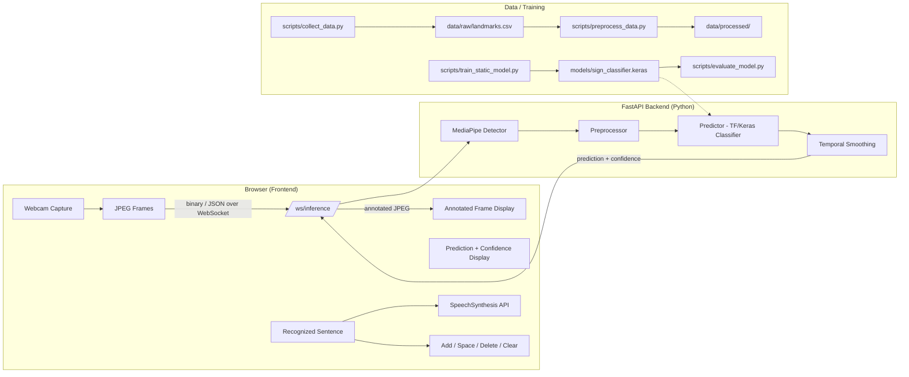

# Real-Time Sign Language Detection and Translation System

An end-to-end, locally runnable AI system that captures hand gestures from a webcam, detects hand landmarks with MediaPipe, classifies trained sign-language gestures, converts them into readable text in real time, and optionally reads the text aloud using the browser's built-in speech synthesis.

This is a **B.Tech Artificial Intelligence and Machine Learning major project**, demonstrating computer vision, deep learning, real-time inference, backend and frontend development, model evaluation, responsible data handling, testing, and documentation.

---

## 1. Problem Statement

Communication with individuals who use sign language often requires a human interpreter. This project addresses the accessibility gap by:

- Detecting sign-language gestures captured through a standard webcam.
- Translating recognized gestures into plain text in real time.
- Reading the recognized text aloud using offline, free browser speech synthesis.

The system runs entirely locally and does **not** depend on any paid cloud API. It uses only open-source, free libraries.

## 2. Proposed Solution

A modular, server-side vision pipeline:

```
Webcam frame (browser)
  → JPEG over localhost WebSocket (server)
  → MediaPipe hand landmarks
  → normalized landmark features
  → trained neural-network classifier
  → confidence filtering
  → temporal smoothing / debounce
  → recognized word
  → sentence builder (browser)
  → (optional) browser text-to-speech
```

Why server-side vision? The Python pipeline (MediaPipe + Keras) is the same code used for training and inference, so preprocessing is guaranteed to match. The browser only handles capture and display. Frames are processed in memory and never persisted.

## 3. Features

- Real-time webcam capture with live FPS and prediction display.
- MediaPipe hand-landmark detection (21 landmarks per hand; the v1 model classifies the primary detected hand, with a documented two-hand extension path in `docs/model.md`).
- Configurable gesture vocabulary (train your own labels).
- Data collection tool to build your own dataset from a webcam.
- Dataset preparation with stratified train/validation/test split.
- Small, CPU-friendly feed-forward neural network for static gestures.
- Careful landmark normalization (translation + scale invariant).
- Confidence thresholding so low-confidence frames do not produce a sign.
- Temporal smoothing/debounce so holding a sign does not spam repeated words.
- Sentence builder (append word, space, delete last token, clear).
- Browser Speech Synthesis "Speak" button (no API key required).
- FastAPI backend with health and model-info endpoints.
- Clean, responsive, accessibility-focused web UI.
- 59 automated tests across configuration, detection, preprocessing, smoothing, prediction, I/O, and API layers.

## 4. Architecture

### Static pipeline (implemented)



### Dynamic signs (documented architecture, not yet implemented)

See `docs/dynamic-signs.md` and the experimental `scripts/collect_dynamic_data.py`. The static classifier is the supported, working pipeline.

## 5. Technology Stack

| Layer | Technology |
| --- | --- |
| Language | Python 3.11 |
| Computer Vision | OpenCV, MediaPipe |
| Machine Learning | TensorFlow / Keras, NumPy, scikit-learn |
| Backend | FastAPI, Uvicorn, WebSockets |
| Frontend | HTML5, CSS3, JavaScript |
| Text-to-Speech | Browser Web Speech API (no API key) |
| Data | NumPy arrays / CSV during collection, JSON for labels |
| Testing | pytest |

## 6. Folder Structure

```
Sign Language Detection/
├── app/
│   ├── api/               # FastAPI routes + WebSocket inference
│   ├── core/              # Config, vocabulary loading
│   ├── ml/                # detector, preprocess, predictor, smoothing, model
│   ├── utils/             # landmark CSV I/O helpers
│   └── main.py            # FastAPI entry point (python -m app.main)
├── configs/
│   └── vocabulary.json    # Configurable gesture vocabulary
├── data/
│   ├── raw/               # Collected landmark samples (CSV)
│   ├── processed/         # Preprocessed train/val/test arrays
│   └── dynamic/           # (experimental) dynamic sign sequences
├── docs/
│   ├── model.md           # Model + preprocessing documentation
│   ├── security.md        # Security and privacy design
│   └── dynamic-signs.md   # Dynamic-sequence architecture note
├── models/                # Trained model artifacts (train locally)
├── reports/               # Evaluation metrics and figures
├── scripts/               # camera/landmark tests, data collection, preprocess, train, evaluate, live CLI
├── static/
│   ├── css/
│   └── js/
├── tests/                 # 59 pytest unit tests
├── .env.example
├── .gitignore
├── requirements.txt
└── README.md
```

## 7. Installation

### Prerequisites

- Python 3.11 (tested on 3.11)
- A working webcam
- A CPU-only laptop is sufficient (GPU optional)

### Steps

```bash
# 1. Open the project directory
cd "Sign Language Detection"

# 2. Create and activate virtual environment
python -m venv .venv

# Windows
.venv\Scripts\activate

# macOS / Linux
# source .venv/bin/activate

# 3. Install dependencies
pip install -r requirements.txt
```

### Environment file

```bash
copy .env.example .env    # Windows
# cp .env.example .env    # macOS / Linux
```

Edit `.env` to match your setup if needed. Sensitive values are never committed; `.env` is ignored by Git.

## 8. Data Collection

The system recognizes **only** the labels you collect and train on. Collect samples under different positions, distances, and lighting conditions.

```bash
python scripts/collect_data.py
```

The tool asks for a gesture label and number of samples, opens the webcam, and saves normalized landmark vectors (not raw video) into `data/raw/`.

> **Experimental (not required):** dynamic sign sequences can be collected with `python scripts/collect_dynamic_data.py --label WAVE --frames 20 --samples 30`. See `docs/dynamic-signs.md`.

## 9. Training

```bash
python scripts/preprocess_data.py   # prepare datasets + label mapping
python scripts/train_static_model.py
```

The best model is saved to `models/sign_classifier.keras` and the label mapping to `models/labels.json`.

> **Note on the bundled model:** the repository ships with `models/sign_classifier.keras` trained on a *synthetic* dataset (FIST, OPEN_HAND, PEACE, THUMBS_UP) so the application can be demonstrated without a real dataset. It is **not** a real-world accuracy claim. Train on your own collected data before drawing any conclusions. Synthetic artifacts are Git-ignored along with trained models.

## 10. Evaluation

```bash
python scripts/evaluate_model.py
```

Writes metrics, per-class classification report, and plots (accuracy/loss curves, confusion matrix) to `reports/`. To check the label mapping:

```bash
python scripts/live_prediction.py
```

## 11. Running the Application

Two modes are available.

### 11a. Web application (recommended)

```bash
python -m app.main
```

Then open <http://localhost:8000> in your browser, press **Start Camera**, and show a trained gesture. Use the sentence-builder buttons or keyboard shortcuts (A = add word, Space = space, Backspace = delete, Esc = clear) and press **Speak** to hear the sentence.

### 11b. Command-line live prediction

```bash
python scripts/live_prediction.py
```

Runs the same detector + preprocessor + predictor + smoothing pipeline in a terminal window with an annotated camera view.

## 12. Testing

```bash
python -m pytest -q
```

Currently **59 tests pass** across:

- Configuration validation (`tests/test_config.py`)
- Hand-landmark detection (`tests/test_detector.py`)
- Preprocessing (`tests/test_preprocess.py`)
- Landmark CSV I/O (`tests/test_landmarks_io.py`)
- Temporal smoothing (`tests/test_smoothing.py`)
- Gesture predictor (`tests/test_predictor.py`)
- FastAPI + WebSocket API (`tests/test_api.py`)

## 13. Model Limitations (Important)

- The system recognizes **only** gestures included in its trained vocabulary.
- Hand-landmark classification alone is **not** equivalent to complete sign-language understanding.
- Many real signs require movement, facial expression, body pose, or context.
- **No accuracy numbers are claimed** in this README until an actual evaluation has been run on a collected dataset.

## 14. Security & Privacy

- Camera frames are processed in memory; webcam frames are **not intentionally saved** during normal inference.
- No third-party APIs, no API keys, no cloud uploads.
- No secrets in source code; see `docs/security.md` for the full design (including production-mode CORS/Debug validation).

## 15. Troubleshooting

| Problem | Fix |
| --- | --- |
| `ImportError: No module named mediapipe` | Run `pip install -r requirements.txt` |
| Webcam not opening | Close other apps using the camera; change `CAMERA_INDEX` in `.env` |
| Model not found | Train first (see Training section) |
| Port 8000 in use | Change `APP_PORT` in `.env` |
| `/ws/inference` connection drops | Close other tabs using the camera; browser must allow webcam access |
| Slow FPS on very old laptops | Reduce `CAMERA_WIDTH`/`CAMERA_HEIGHT` in `.env` |

## 16. Future Scope

See `docs/dynamic-signs.md` for the dynamic (movement) recognition design. Longer-term directions:

- Larger real datasets and multi-speaker generalization.
- Full ISL/ASL sentence structure (grammar, word order).
- Transformer-based sequence models for continuous signing.
- Integration with other sign languages.
- Mobile / on-device deployment.

---

## License

Educational project for academic use.